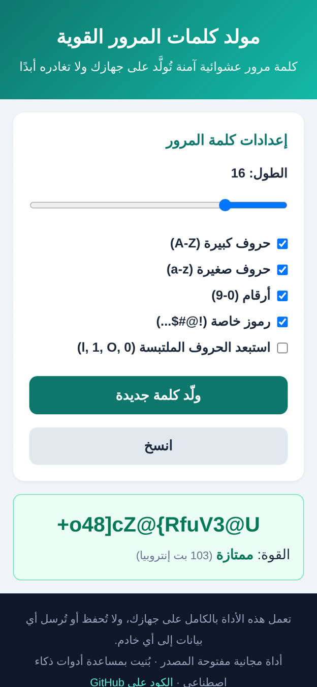

# Password Generator | مولد كلمات المرور القوية

Generate strong random passwords with the length and character types you choose, with a live strength meter. Arabic interface.

**Live app:** https://abood-ayman.github.io/password-generator-ar/

**LinkedIn:** [Project entry](https://www.linkedin.com/in/abdullah-ayman-1678b737b/details/projects/)

This is a personal project, built with AI tools.

## Features
- True randomness using your browser's crypto generator
- Control length (4-64) and character types: upper, lower, digits, symbols
- Option to exclude ambiguous characters (l, 1, O, 0)
- Entropy-based strength meter and one-click copy

## Privacy
Everything runs in your browser. No data is stored or sent anywhere.

## Run locally
Open `index.html` in any browser. It is a single static page with no dependencies.

## Status
Stable.

## Copyright
MIT License - Copyright (c) 2026 Abdullah Ayman.
